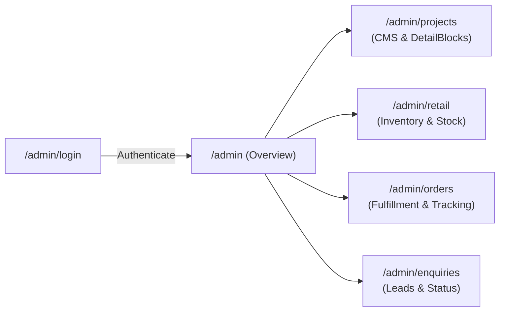
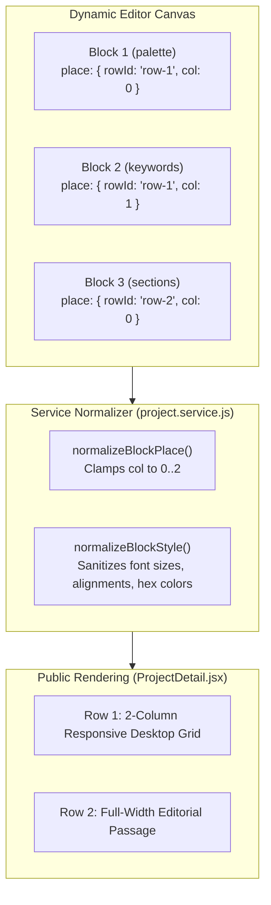
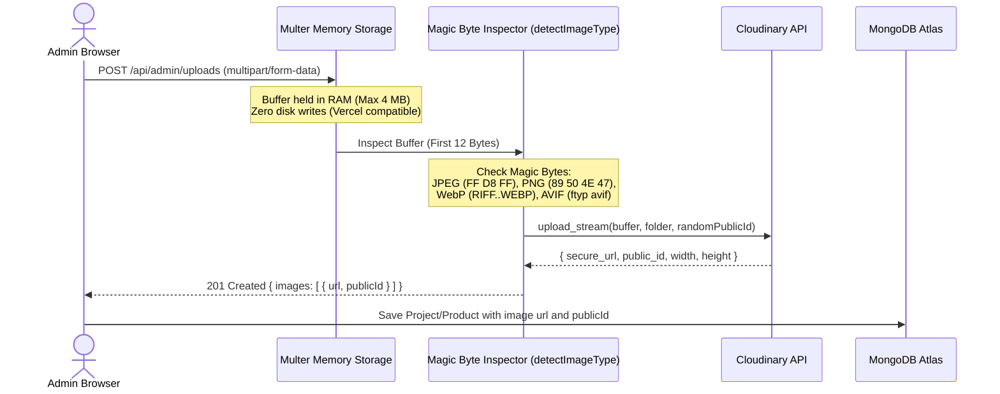
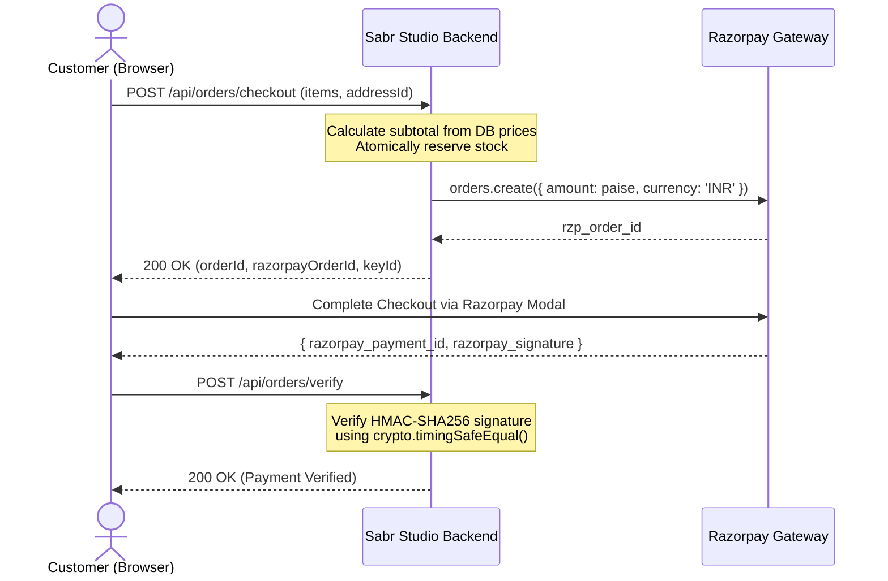
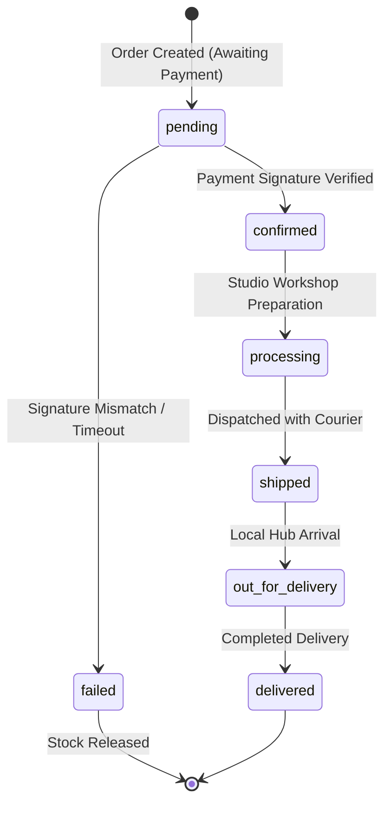
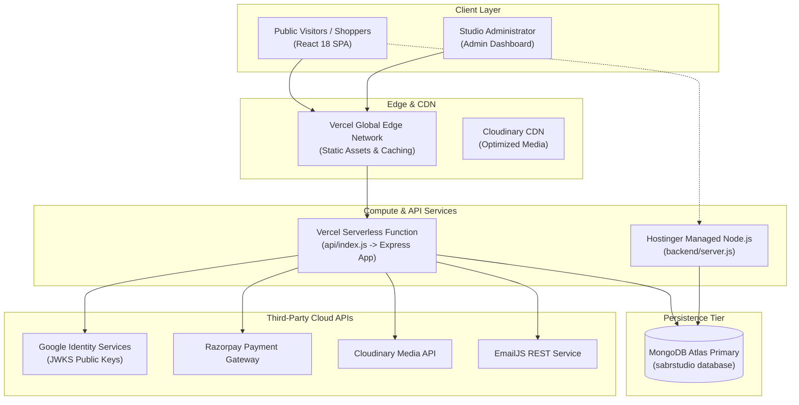
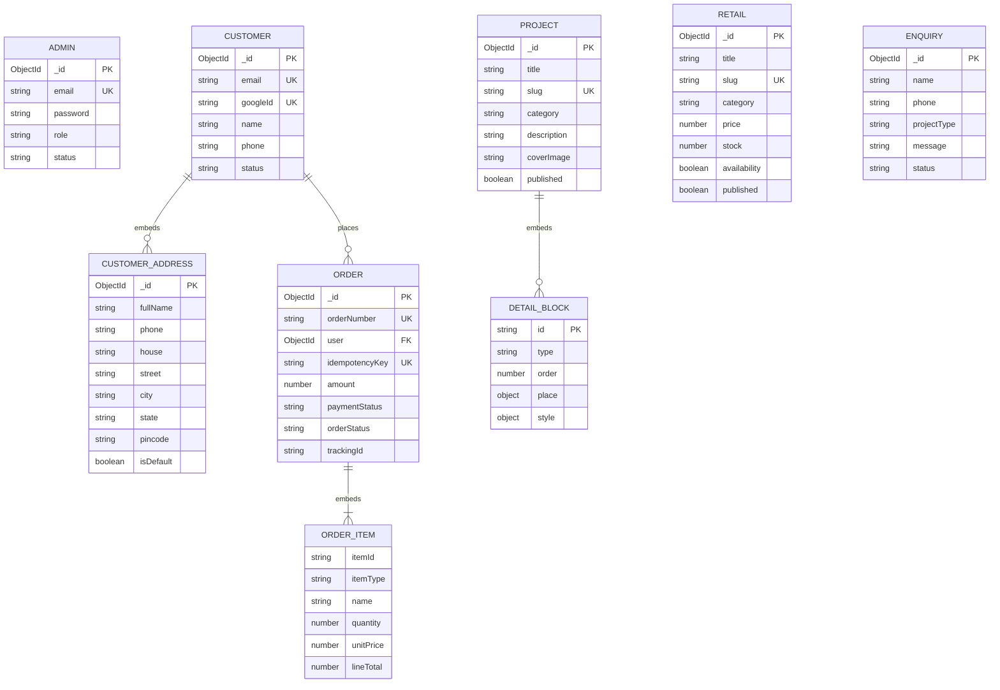

<div align="center">

# 🏛️ SABR STUDIO
### *Architectural Design Portfolio & Bespoke E-Commerce Atelier*

<p align="center">
  <strong>A high-end, editorial full-stack web application designed for a luxury architectural practice and handcrafted furniture atelier.</strong><br>
  Built from first principles to unite an editorial design showcase, a dynamic visual content management system (CMS), an e-commerce catalogue, and an administrative operations engine.
</p>

<p align="center">
  <a href="https://sabrstudio.in/">
    
  </a>
  <a href="https://sabr-studio.vercel.app/">
    
  </a>
  <a href="https://github.com/Abu-Fazal/Sabr-Studio">
    
  </a>
</p>

---

### ⚡ Technology & Architecture Badges

<!-- Platform & Runtimes -->
[](https://nodejs.org/)
[](https://react.dev/)
[](https://vitejs.dev/)
[](https://expressjs.com/)
[](https://www.mongodb.com/atlas)
[](https://tailwindcss.com/)

<!-- Integrations & Cloud Services -->
[](https://razorpay.com/)
[](https://cloudinary.com/)
[](https://developers.google.com/identity)
[](https://www.framer.com/motion/)
[](https://github.com/darkroomengineering/lenis)
[](https://opensource.org/licenses/MIT)

</div>

---

## 🖼️ Screenshots & Interface Tour

The visual design of Sabr Studio is rooted in minimalism, tactile material palettes, editorial typography (`Abhaya Libre` and `Inter`), and deliberate whitespace. Capture specifications and viewport details can be reviewed in the [Screenshot Capture Guide](file:///d:/OneDrive/Desktop/SabrStudio/docs/screenshots/README.md).

<div align="center">

| 🏛️ Architectural Portfolio View | 🛋️ Bespoke Retail Atelier |
|:---:|:---:|
| <br/><sub><strong>Curated architectural portfolio with real-time category filtering</strong></sub> | <br/><sub><strong>Furniture & objects catalogue with live stock and price validation</strong></sub> |

| 🎨 Dynamic Content Canvas (CMS) | 📦 Administrative Fulfillment Hub |
|:---:|:---:|
| <br/><sub><strong>Drag-and-drop 2D block editor with material color swatches</strong></sub> | <br/><sub><strong>Fulfillment tracking, payment status badges, and courier logging</strong></sub> |

</div>

> [!TIP]
> **Screenshot Directory:** High-resolution screenshots should be placed in `docs/screenshots/` matching the filenames defined in the [Screenshot Capture Guide](file:///d:/OneDrive/Desktop/SabrStudio/docs/screenshots/README.md).

---

## 📑 Table of Contents

<div align="center">

| Category | Primary Sections |
|---|---|
| **🏛️ Overview & Strategy** | [01. Project Overview](#01-project-overview) • [02. Project Background](#02-project-background) • [03. Key Highlights](#03-key-highlights) • [04. Complete Features](#04-complete-features) |
| **🌐 Storefront Experience** | [05. Public Website](#05-public-website) • [12. Retail Management](#12-retail-management) • [13. E-commerce System](#13-e-commerce-system) • [14. Payment Integration](#14-payment-integration) |
| **🛠️ Administrative Suite** | [06. Admin Dashboard](#06-admin-dashboard) • [09. Project Management CMS](#09-project-management-cms) • [10. Dynamic Content Editor](#10-dynamic-content-editor) • [11. Media Management](#11-media-management) |
| **🔐 Identity & Access** | [07. Role-Based Access Control](#07-role-based-access-control) • [08. Authentication System](#08-authentication-system) • [16. Customer Management](#16-customer-management) • [17. Enquiry Management](#17-enquiry-management) • [15. Order Management](#15-order-management) |
| **🏗️ Engineering & APIs** | [18. System Architecture](#18-system-architecture) • [19. Backend Architecture](#19-backend-architecture) • [20. Database Design](#20-database-design) • [21. API Documentation](#21-api-documentation) |
| **🛡️ Resilience & Testing** | [22. Security Architecture](#22-security) • [23. Error Handling](#23-error-handling) • [24. Automated Testing](#24-testing) • [32. Performance Optimization](#32-performance-optimization) |
| **🚀 DevOps & Operations** | [25. Technology Stack](#25-technology-stack) • [26. Project Structure](#26-project-structure) • [27. Installation](#27-installation) • [28. Environment Variables](#28-environment-variables) • [29. Available Scripts](#29-available-scripts) • [30. Local Development](#30-local-development) • [31. Production Deployment](#31-production-deployment) |
| **💼 Case Study & Meta** | [33. Challenges & Solutions](#33-challenges--solutions) • [34. Freelance Experience](#34-freelance-project-experience) • [35. Future Improvements](#35-future-improvements) • [36. Author & Credits](#36-author--credits) • [37. License](#37-license) |

</div>

---

<a name="01-project-overview"></a>
## 01. 🚀 Project Overview

**Sabr Studio** is a custom-engineered full-stack platform built for a multidisciplinary architecture studio and bespoke furniture atelier. Unlike off-the-shelf templates or generic site builders that enforce rigid layouts, Sabr Studio combines:

1. **An Editorial Architectural Showcase:** Presenting completed residential, commercial, and hospitality projects with dynamic material palettes, spatial specifications, and narrative case studies.
2. **A Custom Dynamic Content Editor (CMS):** A purpose-built, block-based visual canvas allowing administrators to construct bespoke project case studies with 2D column placement, custom typography scales, and material swatches.
3. **An Atelier Furniture Catalogue:** An e-commerce system featuring real-time inventory reservation, server-side price validation, and multi-item ordering.
4. **An Administrative Operations Engine:** A central hub for managing client enquiries, updating catalogue stock levels, fulfilling orders, and auditing studio analytics.

### Target User Personas

```
┌──────────────────────────────────────────────┐    ┌──────────────────────────────────────────────┐
│       Design Connoisseurs & Shoppers         │    │             Studio Administrators            │
├──────────────────────────────────────────────┤    ├──────────────────────────────────────────────┤
│ • Browse architectural case studies          │    │ • Curate portfolio & publish case studies    │
│ • Inspect tactile materials & palettes       │    │ • Visual 2D block composition & styling      │
│ • Curate carts with localStorage sync        │    │ • Direct Cloudinary media pipeline           │
│ • Google 1-click checkout with Razorpay      │    │ • Live stock counters & price controls       │
│ • Self-service address book & order tracking │    │ • Client enquiry triage & order fulfillment  │
└──────────────────────────────────────────────┘    └──────────────────────────────────────────────┘
```

---

<a name="02-project-background"></a>
## 02. 📖 Project Background

Sabr Studio represents my first major full-stack freelance engineering engagement. The client—an emerging boutique architecture and interior design practice—required a digital presence that matched the tactile sophistication and minimalist craftsmanship of their physical work.

### The Architectural Dilemma
- **Standard CMS platforms (WordPress/Squarespace):** Suffered from bloated bundle sizes, rigid templating limitations, and sluggish performance on mobile devices.
- **SaaS E-commerce (Shopify):** Did not natively accommodate custom architectural case studies with dynamic material palettes and spatial highlights while maintaining an editorial brand aesthetic.

### The Custom Engineering Response
I engineered a tailor-made monorepo application using **React 18**, **Node.js/Express**, and **MongoDB Atlas**. I designed the architecture to support dual production deployment modes: deploying as serverless lambdas on **Vercel** while remaining completely compatible with long-lived managed Node.js runtimes like **Hostinger**.

---

<a name="03-key-highlights"></a>
## 03. ✨ Key Highlights

<div align="center">

| Feature Highlight | Implementation Detail | Technical Benefit |
|---|---|---|
| **Dual-Track Authentication** | Admin bcrypt JWT + Customer Google Identity Services | Complete isolation; zero credential leakage between roles |
| **Dynamic DetailBlocks CMS** | 2D placement engine (`place.rowId`, `place.col`) | Bespoke multi-column responsive editorial layouts without code |
| **Zero-Disk Media Pipeline** | `multer.memoryStorage()` + Magic Byte Sniffing | 100% serverless read-only compatibility & anti-spoofing defense |
| **Zero-Trust E-Commerce** | Server-side price authority + Atomic stock locks | Prevents client-side price tampering and race condition overselling |
| **Cryptographic Verification** | Synchronous HMAC-SHA256 (`timingSafeEqual`) + Webhooks | Eliminates payment fraud, man-in-the-middle attacks, and replay risks |
| **Production DB Fail-Safe** | Health check interceptor returning `503 DB_UNAVAILABLE` | Prevents serving corrupted or fake in-memory fixtures in production |
| **Silky 60fps Experience** | Lenis smooth scroll + Font preloading + Code splitting | Zero Layout Shift (CLS) and instant route transitions |

</div>

---

<a name="04-complete-features"></a>
## 04. 🎯 Complete Features

```
Sabr Studio Feature Matrix
├── 🌐 Public Storefront & Portfolio
│   ├── Editorial Landing Page (Hero carousel, design philosophy, process steps, FAQ)
│   ├── Architectural Portfolio (Category filters: Residential, Commercial, Hospitality)
│   ├── Case Study View (Dynamic 2D blocks, material swatches, high-res photography)
│   ├── Furniture Catalogue (Pricing, dimensions, materials, stock availability)
│   ├── Product Detail View (Specifications, multi-image gallery, add-to-cart)
│   ├── Slide-over Cart Drawer (Quantity selectors, persistent localStorage sync)
│   ├── Multi-Step Checkout (Saved address book, live stock validation)
│   ├── Customer Portal (Order history, tracking IDs, profile management)
│   └── Inbound Consultation Enquiry Form (Rate-limited, EmailJS alerts)
│
└── 🛠️ Administrative Command Center
    ├── Key Metric Dashboards (Total revenue, order counts, lead conversion)
    ├── Project CMS (Create, edit, reorder, publish/unpublish, delete)
    ├── Dynamic DetailBlocks Canvas (Place row/col slots, configure design tokens)
    ├── Media Asset Pipeline (Direct Cloudinary upload, auto-deletion on replace)
    ├── Retail Inventory Manager (Real-time stock counters, price controls)
    ├── Order Fulfillment Hub (Fulfillment status transitions, courier tracking IDs)
    └── Enquiry Management (Lead status tracking: new, contacted, pending)
```

---

<a name="05-public-website"></a>
## 05. 🌐 Public Website

The public interface is designed with an editorial aesthetic, utilizing generous whitespace and deliberate typographic contrast between `Abhaya Libre` (serif) and `Inter` (sans-serif).

### Public Routes & Page Architecture

1. **Home (`/`):**
   - Features an animated hero slider (`HeroSlider.jsx`) showcasing featured works.
   - Includes studio statistics, design philosophy highlights, interactive FAQ accordions (`FaqAccordionItem.jsx`), and client testimonials.
2. **Projects Listing (`/projects`):**
   - Fetches live published works via `GET /api/projects`.
   - Offers real-time category filtering (**Residential**, **Commercial**, **Hospitality**) without full page reloads.
3. **Project Detail (`/projects/:slug`):**
   - Renders deep-dive case studies dynamically using `DetailBlockContent.jsx`.
   - Reconstructs 2D multi-column rows using `groupBlocksIntoRows()` to faithfully reflect the admin builder's canvas.
4. **Retail Catalogue (`/retail` & `/retail/:slug`):**
   - Displays furniture, lighting, and decor objects.
   - Accurately renders dimensions, material compositions, stock availability, and prices in INR.
5. **Contact & Consultation (`/contact`):**
   - Collects prospect details, required project type, and design briefs.
   - Guarded by `enquiryLimiter` (5 submissions per 15 minutes) and automated EmailJS email alerts.

---

<a name="06-admin-dashboard"></a>
## 06. 🛠️ Admin Dashboard

The administrative dashboard (`/admin`) is an integrated management environment protected by `ProtectedRoute.jsx`.



### Dashboard Operational Capabilities
- **Overview Analytics:** Real-time calculation of total studio revenue, confirmed order volume, active catalogue listings, and unhandled client leads (`GET /api/admin/stats`).
- **Project CMS:** Visual management of portfolio projects with one-click publish/unpublish toggles.
- **Inventory Controller:** Direct modification of product pricing, availability toggles, and physical stock counts.
- **Order Tracking:** Update fulfillment states (`pending` $\rightarrow$ `confirmed` $\rightarrow$ `processing` $\rightarrow$ `shipped` $\rightarrow$ `delivered`) and assign courier tracking IDs.
- **Enquiry Ledger:** Inbound inquiry triage with status tags (`new`, `contacted`, `pending`) and direct communication metadata.

---

<a name="07-role-based-access-control"></a>
## 07. 👥 Role-Based Access Control

Sabr Studio strictly isolates administrative permissions from customer shopping accounts. The application does not mix permissions on a single user table.

| User Role | Identification Credential | Accessible Scope | Prohibited Scope |
|---|---|---|---|
| **Anonymous Visitor** | None (Unauthenticated) | Public browsing (`/`, `/projects`, `/retail`), enquiry submissions | Admin portal, customer checkout, order history |
| **Retail Customer** | Google Identity Token (RS256) | Profile editing, address book, checkout, personal order history (`/orders`) | Administrative dashboard, product creation, project editing |
| **Studio Administrator** | Email + bcrypt password hash | Full administrative dashboard (`/admin/*`), CMS, media uploads, fulfillment | Cannot spoof customer orders or bypass payment checks |

> [!IMPORTANT]
> **Strict Administrative Immutability:** Even administrators with valid credentials **cannot** manually update an order's `paymentStatus` or alter the `amount` of an order. The payment status can only be advanced through cryptographic Razorpay signature verification or authenticated webhooks.

---

<a name="08-authentication-system"></a>
## 08. 🔐 Authentication System

The application features two independent authentication engines operating in parallel:

```mermaid
flowchart TD
    subgraph AdminAuthPipeline["Admin Authentication Pipeline"]
        A1["Admin submits Email & Password"] --> A2["Rate Limiter (5 attempts / 15 min)"]
        A2 --> A3["Query Admin Collection (select: +password)"]
        A3 --> A4["bcrypt.compare(password, hash)"]
        A4 -->|Success| A5["Sign JWT (id, role: admin)"]
        A5 --> A6["Set HTTP-only Cookie: token"]
    end

    subgraph CustomerAuthPipeline["Customer Authentication Pipeline"]
        C1["Shopper signs in via Google GIS"] --> C2["Frontend receives Google ID Token"]
        C2 --> C3["POST /api/customer/google"]
        C3 --> C4["Backend verifies token against Google JWKS (RS256)"]
        C4 --> C5["Extract verified Google sub claim"]
        C5 --> C6["Find or Create Customer in DB"]
        C6 --> C7["Sign Customer JWT (id, role: customer)"]
        C7 --> C8["Set HTTP-only Cookie: sabr_customer (365d TTL)"]
    end
```



### Customer Self-Service Account Lifecycle
- **Just-in-Time Provisioning:** Shopper accounts are created automatically upon the first successful Google login.
- **Soft Deletion & Data Retention:** When a customer deletes their account via `DELETE /api/customer/account`, personal identifiable information (PII) is anonymized, but the historical order document is retained for accounting and statutory compliance. Future logins with that token return `401 Unauthorized (CUSTOMER_ACCOUNT_DELETED)`.

---

<a name="09-project-management-cms"></a>
## 09. 📁 Project Management CMS

The portfolio CMS manages architectural case studies through structured MongoDB documents.

### Project Data Flow
1. **Form Creation:** The admin inputs standard project metadata (Title, Slug, Category, Location, Area, Year, Client Brief, Cover Image).
2. **Dynamic Canvas:** The admin adds content blocks using the visual editor.
3. **Payload Sanitization:** The backend service (`project.service.js`) validates all block types, strips unknown properties, clamps placement indices, and saves the document to MongoDB.
4. **Public Aggregation:** Public visitors query projects by slug. The backend returns only published projects, sorting gallery assets and formatting content blocks.

---

<a name="10-dynamic-content-editor"></a>
## 10. 🎨 Dynamic Content Editor

The dynamic content builder (`DetailBlocksEditor.jsx`) gives administrators complete editorial freedom over project presentation without writing code.



### Supported Block Specifications (`backend/utils/detailBlockSpec.js`)
- **`palette`**: Swatches with color name, hex/rgba values, and material description.
- **`keywords`**: Conceptual design themes and architectural tags.
- **`lists`**: Formatted requirements, features, or spatial components with list style tokens (`disc`, `decimal`, `check`, `none`).
- **`sections`**: Long-form editorial narratives with headings and multiple paragraphs.
- **`imageBlocks`**: Visual showcases supporting Cloudinary URLs, captions, subheadings, and layout tokens (`half`, `full`, `third`).

---

<a name="11-media-management"></a>
## 11. ☁️ Media Management

Media uploads are handled through a zero-disk, memory-buffered pipeline integrating Multer and Cloudinary.



### Media Security Highlights
- **Serverless Compatibility:** By never writing files to the local file system (`multer.memoryStorage()`), the upload pipeline functions flawlessly within Vercel's read-only serverless execution environment.
- **Magic-Byte Verification:** Defends against malicious files disguised with fake image extensions by inspecting raw byte signatures.
- **Automated Invalidation & Cleanup:** Replacing a cover image triggers `deleteAsset(publicId)` on Cloudinary, preventing orphaned assets from accumulating.

---

<a name="12-retail-management"></a>
## 12. 🛋️ Retail Management

The atelier retail module manages handcrafted furniture, lighting, and decorative objects.

### Retail Operations
- **Stock Tracking:** Products support both finite numerical inventory (`stock: 12`) and legacy untracked availability (`stock: null, inStock: true`).
- **Category Taxonomy:** Category taxonomy (Chair, Table, Lighting, Storage, Decor, Sofa, Objects) managed via dedicated endpoints (`/api/admin/retail/categories`).
- **Low-Stock Visibility:** Database indexes on `{ stock: 1 }` allow administrators to quickly filter low-stock items.

---

<a name="13-ecommerce-system"></a>
## 13. 🛒 E-commerce System

The e-commerce subsystem handles the entire journey from browsing to cart management and address selection.

### Cart Architecture (`CartContext.jsx`)
- **Persistence:** Synchronizes automatically with `localStorage` (`sabr_cart_v1`), ensuring cart items survive browser reloads and navigation between pages.
- **Deduplication:** Uses canonical product identification comparing stringified `id`, `_id`, and `slug` to prevent duplicate line items.
- **Selective Eviction:** Upon successful payment, `removePurchasedItems(purchasedIds)` removes only the successfully purchased items, leaving any unpurchased items intact.

---

<a name="14-payment-integration"></a>
## 14. 💳 Payment Integration

Sabr Studio integrates with Razorpay, enforcing strict server-side calculation and cryptographic signature verification.



<details>
<summary><strong>View Server-Side Signature Verification Logic</strong></summary>

```javascript
// Timing-safe cryptographic HMAC-SHA256 verification (order.service.js)
const bodyStr = `${razorpayOrderId}|${razorpayPaymentId}`;
const expected = crypto.createHmac('sha256', process.env.RAZORPAY_KEY_SECRET)
  .update(bodyStr)
  .digest('hex');

const a = Buffer.from(expected);
const b = Buffer.from(String(razorpaySignature));
const isValid = a.length === b.length && crypto.timingSafeEqual(a, b);
```
</details>

---

<a name="15-order-management"></a>
## 15. 📦 Order Management

Orders transition through a defined lifecycle, capturing complete item snapshots at the moment of checkout.



### Data Snapshots
To protect financial and historical accuracy, orders do not rely on live joins with the product catalogue. Instead, complete product snapshots (unit price, product title, primary image, delivery address lines) are embedded permanently into the order record upon creation.

---

<a name="16-customer-management"></a>
## 16. 👤 Customer Management

Customer profiles and address books are securely managed through dedicated customer endpoints.

- **Profile Updates:** Customers can update their name and phone number (`PUT /api/customer/profile`). The email address is derived directly from the verified Google Identity token and is immutable.
- **Address Book:** Full CRUD support for delivery addresses (`/api/customer/addresses`), including default address toggling.
- **Order Retrieval:** Customers can view their personal order history (`GET /api/orders/my`), secured by ownership checks ensuring shoppers can only view their own orders.

---

<a name="17-enquiry-management"></a>
## 17. 📩 Enquiry Management

Inbound client consultations and architectural project inquiries are handled through the `/contact` form and managed in the admin dashboard.

- **Data Capture:** Inquiries capture the prospect's name, phone number, email (optional), design service category (`projectType`), and message.
- **Automated Notification:** When an inquiry is submitted, the backend triggers an automated email notification via EmailJS REST API (`emailjs.service.js`).
- **Triage Workflow:** Administrators track leads through statuses: `new` $\rightarrow$ `contacted` $\rightarrow$ `pending`.

---

<a name="18-system-architecture"></a>
## 18. 🏗️ System Architecture

The high-level architecture diagram illustrates the end-to-end integration across client browsers, edge networks, compute layers, and persistent storage.



---

<a name="19-backend-architecture"></a>
## 19. ⚙️ Backend Architecture

The backend implements a clean layered design separating HTTP concerns from business logic and data access.

```
Request Flow Architecture
Request
  │
  ▼
[Security Middleware] (Helmet, CORS, Rate Limiters)
  │
  ▼
[Authentication Gate] (protect / protectCustomer)
  │
  ▼
[Validation Chain]    (express-validator schemas)
  │
  ▼
[Controller Layer]    (Parameter extraction & HTTP envelopes)
  │
  ▼
[Service Layer]       (Domain logic, normalization, external APIs)
  │
  ▼
[Mongoose Models]     (Schema validation, hooks, database queries)
  │
  ▼
MongoDB Atlas
```

---

<a name="20-database-design"></a>
## 20. 🗄️ Database Design

### Entity Relationship Diagram



---

<a name="21-api-documentation"></a>
## 21. 🔌 API Documentation

All API endpoints reside under the `/api` prefix and return standard JSON envelopes:
`{ "success": boolean, "data"?: any, "message"?: string, "errors"?: Array }`.

### Module Endpoints Summary

<details open>
<summary><strong>Public APIs (No Authentication Required)</strong></summary>

| Method | Endpoint | Purpose | Access |
|---|---|---|:---:|
| `GET` | `/health` | Health check & database connection probe | Public |
| `GET` | `/api/config/public` | Public Google Client ID for GIS button | Public |
| `GET` | `/api/projects` | List published architectural projects | Public |
| `GET` | `/api/projects/categories` | List project categories | Public |
| `GET` | `/api/projects/:slug` | Get published project details by slug | Public |
| `GET` | `/api/retail` | List published retail catalogue items | Public |
| `GET` | `/api/retail/:slug` | Get retail product details by slug | Public |
| `POST` | `/api/enquiries` | Submit client consultation enquiry | Public (Rate Limited) |

</details>

<details>
<summary><strong>Customer APIs (Cookie: `sabr_customer` Required)</strong></summary>

| Method | Endpoint | Purpose | Access |
|---|---|---|:---:|
| `POST` | `/api/customer/google` | Exchange Google ID token for session cookie | Public (GIS) |
| `GET` | `/api/customer/me` | Return authenticated customer profile | Customer |
| `POST` | `/api/customer/logout` | Clear customer session cookie | Customer |
| `PUT` | `/api/customer/profile` | Update customer profile (name, phone) | Customer |
| `DELETE` | `/api/customer/account` | Anonymize PII & soft-delete account | Customer |
| `GET` | `/api/customer/addresses` | List saved delivery addresses | Customer |
| `POST` | `/api/customer/addresses` | Create new delivery address | Customer |
| `PATCH` | `/api/customer/addresses/:id/default` | Set default delivery address | Customer |
| `DELETE` | `/api/customer/addresses/:id` | Remove delivery address | Customer |
| `POST` | `/api/orders/checkout` | Create order & initiate Razorpay session | Customer |
| `POST` | `/api/orders/verify` | Verify Razorpay payment signature | Customer |
| `GET` | `/api/orders/my` | Retrieve customer's past orders | Customer |
| `GET` | `/api/orders/my/:id` | Retrieve single order details | Customer |

</details>

<details>
<summary><strong>Administrative APIs (Cookie: `token` Required)</strong></summary>

| Method | Endpoint | Purpose | Access |
|---|---|---|:---:|
| `POST` | `/api/auth/login` | Authenticate admin via credentials | Public (Rate Limited) |
| `GET` | `/api/auth/me` | Validate admin session | Admin |
| `POST` | `/api/auth/logout` | Invalidate admin session cookie | Admin |
| `GET` | `/api/admin/stats` | Dashboard metrics & revenue | Admin |
| `GET` | `/api/admin/projects` | List all projects (drafts & published) | Admin |
| `POST` | `/api/admin/projects` | Create a new project | Admin |
| `PUT` | `/api/admin/projects/:id` | Update project specifications/blocks | Admin |
| `DELETE` | `/api/admin/projects/:id` | Delete project and Cloudinary media | Admin |
| `GET` | `/api/admin/retail` | List all catalogue items | Admin |
| `POST` | `/api/admin/retail` | Create new retail catalogue item | Admin |
| `PUT` | `/api/admin/retail/:id` | Update product specs/stock | Admin |
| `DELETE` | `/api/admin/retail/:id` | Delete product and Cloudinary media | Admin |
| `GET` | `/api/admin/enquiries` | List client consultation inquiries | Admin |
| `PATCH` | `/api/admin/enquiries/:id/status` | Update inquiry status tag | Admin |
| `DELETE` | `/api/admin/enquiries/:id` | Delete an enquiry | Admin |
| `GET` | `/api/admin/orders` | List all orders across all customers | Admin |
| `PATCH` | `/api/admin/orders/:id/status` | Update order fulfillment status | Admin |
| `PATCH` | `/api/admin/orders/:id/tracking` | Update courier tracking ID | Admin |
| `POST` | `/api/admin/uploads` | Stream image buffer to Cloudinary | Admin |

</details>

---

<a name="22-security"></a>
## 22. 🛡️ Security

The platform enforces defense-in-depth principles across all architectural layers:

1. **Authentication Separation:** Admin credentials and customer tokens use distinct cookie names, token structures, and middleware verification routines.
2. **Timing-Safe Crypto:** All password and payment signature comparisons use `crypto.timingSafeEqual()` or `bcrypt.compare()` to protect against timing attacks.
3. **Multi-Tier Rate Limiting:**
   - Admin Login: 5 requests per 15 minutes (`authLimiter`).
   - Admin Operations: 50 requests per 15 minutes (`adminLimiter`).
   - Client Enquiries: 5 requests per 15 minutes (`enquiryLimiter`).
   - Checkout & Payments: 30 requests per 15 minutes (`checkoutLimiter`).
   - General API: 100 requests per 15 minutes (`generalLimiter`).
4. **Header Protection:** Helmet security headers, cross-origin resource policy enforcement, and CORS whitelisting.
5. **Payload Limits:** Request bodies restricted to 10 MB, and multipart file uploads capped at 4 MB.

---

<a name="23-error-handling"></a>
## 23. 🚨 Error Handling

- **Centralized Error Middleware (`error.middleware.js`):** Intercepts unhandled errors, logs detailed diagnostics via Pino server-side, and returns sanitized, user-friendly JSON responses to clients.
- **Client Error Boundary (`ErrorBoundary.jsx`):** Wraps the React application to isolate frontend rendering crashes without blank-screening the entire interface.
- **Graceful Database Degraded States:** During local development without MongoDB Atlas, the system seamlessly transitions to in-memory fixtures. In production, it fails closed with an explicit `503 Service Unavailable (DB_UNAVAILABLE)`.

---

<a name="24-testing"></a>
## 24. 🧪 Testing

Automated testing covers critical business workflows and regression points:

1. **Detail Blocks Persistence Test (`backend/tests/project-detail-blocks.test.js`):**
   - Verifies that Mongoose schemas do not strip `place` or `style` properties in strict mode.
   - Validates multi-column 2D placement logic and backward compatibility with legacy blocks.
2. **Image Block Regression Test (`backend/tests/project-image-blocks.test.js`):**
   - Ensures Cloudinary URLs within nested image blocks are preserved during document updates.
3. **Route Integration Suite (`scripts/test-all-routes.mjs`):**
   - End-to-end integration harness exercising public routes, customer flows, admin authentication, checkout, and payment simulation.

```bash
# Execute unit tests
npm --prefix backend run test:unit

# Execute route integration suite
npm run test:routes
```

---

<a name="25-technology-stack"></a>
## 25. 💻 Technology Stack

<div align="center">

| Tier | Primary Technologies | Version | Purpose |
|---|---|:---:|---|
| **Frontend Framework** | React | `^18.3.1` | Declarative component UI engine |
| **Build Tool** | Vite | `^5.4.21` | Lightning-fast HMR and bundle compilation |
| **CSS Architecture** | Tailwind CSS | `^3.4.11` | Utility-first responsive design system |
| **Micro-Interactions** | Framer Motion | `^11.5.4` | Fluid UI transitions and page animations |
| **Smooth Scroll** | Lenis | `^1.1.13` | Inertial smooth scrolling experience |
| **Routing** | React Router DOM | `^6.26.2` | Client-side SPA routing with code-splitting |
| **HTTP Client** | Axios | `^1.7.7` | Standardized API client with interceptors |
| **Backend Runtime** | Node.js (ESM) | `>=20.0.0` | Native ECMAScript Modules server runtime |
| **Web Server** | Express | `^4.21.0` | REST API routing and middleware pipeline |
| **Database & ODM** | MongoDB Atlas & Mongoose | `^8.6.2` | Document database and strict schema validation |
| **Authentication** | JSONWebToken & bcrypt | `^9.0.2` / `^6.0.0` | Salted password hashing and JWT issuance |
| **Media Engine** | Multer & Cloudinary SDK | `1.4.5` / `^2.5.0` | In-memory buffering and CDN asset hosting |
| **Payment Gateway** | Razorpay Node SDK | `^2.9.4` | Secure order creation and HMAC verification |
| **Security Suite** | Helmet & Rate Limit | `^7.1.0` / `^7.4.0` | Security headers and multi-tier DDoS throttling |

</div>

---

<a name="26-project-structure"></a>
## 26. 📂 Project Structure

```
SabrStudio/
├── .github/workflows/ci.yml       # GitHub Actions CI workflow
├── api/
│   └── index.js                   # Vercel serverless function entry
├── backend/
│   ├── config/                    # DB connection & env verification
│   ├── constants/                 # Domain constants
│   ├── controllers/               # Express route handlers
│   ├── middlewares/               # Auth, rate-limit, upload, error handlers
│   ├── models/                    # Mongoose schemas (Admin, Project, Order, etc.)
│   ├── services/                  # Business logic (Razorpay, Cloudinary, CMS)
│   ├── tests/                     # Unit & regression test suites
│   ├── utils/                     # Block spec, logger, fallback fixtures
│   ├── validators/                # express-validator schemas
│   ├── apiHandler.js              # Central isomorphic API router
│   ├── app.js                     # Express app configuration
│   └── server.js                  # Production long-lived entry point
├── frontend/
│   ├── public/                    # Favicons, webmanifest, sitemap
│   ├── src/
│   │   ├── app/                   # App.jsx, AppRouter.jsx, ProtectedRoute.jsx
│   │   ├── assets/                # Typography (Abhaya Libre, Inter), icons, logos
│   │   ├── features/              # Feature modules (projects, retail, admin, cart)
│   │   ├── shared/                # Contexts (Auth, Cart, Customer), layouts, UI components
│   │   └── main.jsx               # React DOM entry point
│   └── vite.config.js             # Vite build & proxy setup
├── scripts/
│   ├── build.mjs                  # Monorepo build orchestrator
│   ├── dev.mjs                    # Dual-process local boot script
│   ├── sync-indexes.mjs           # MongoDB index synchronizer
│   └── test-all-routes.mjs        # Route integration test harness
├── DEPLOY.md                      # Production deployment manual
├── hostinger.md                   # Hostinger deployment runbook
├── vercel.json                    # Vercel rewrites, caching & function headers
└── package.json                   # Root monorepo scripts & dependencies
```

---

<a name="27-installation"></a>
## 27. 🚀 Installation

### Prerequisites
- **Node.js:** Version 20.0.0 or higher
- **npm:** Version 9.0.0 or higher
- **MongoDB:** Active MongoDB Atlas URI (or runs in fallback mode locally)

### Step-by-Step Setup
```bash
# 1. Clone the repository
git clone https://github.com/Abu-Fazal/Sabr-Studio.git
cd Sabr-Studio

# 2. Install dependencies across backend and frontend
npm run install:all

# 3. Configure backend environment
cp backend/.env.example backend/.env
# Open backend/.env and populate your secrets

# 4. Configure frontend environment
cp frontend/.env.example frontend/.env
```

---

<a name="28-environment-variables"></a>
## 28. 🔑 Environment Variables

All sensitive credentials remain strictly server-side. The frontend requires only a single configuration parameter.

### Backend Configuration (`backend/.env`)

<div align="center">

| Variable | Purpose | Required in Prod | Safe Example |
|---|---|:---:|---|
| `PORT` | Listening port for Express server | Yes (Host-injected) | `3000` |
| `NODE_ENV` | Runtime environment flag | Yes | `production` |
| `SERVE_FRONTEND` | Serves `frontend/dist` in monolithic hosting | Yes (Hostinger) | `true` |
| `MONGODB_URI` | MongoDB Atlas connection string | Yes | `mongodb+srv://<db_username>:<db_password>@<cluster_host>/sabrstudio` |
| `MONGODB_DB_NAME` | Explicit database name | Yes | `sabrstudio` |
| `JWT_SECRET` | Signing secret for admin tokens (≥32 chars) | Yes | `<your_32_character_jwt_secret_here>` |
| `JWT_EXPIRES_IN` | Admin session lifetime | No | `7d` |
| `CUSTOMER_JWT_EXPIRES_IN`| Customer session lifetime | No | `365d` |
| `ADMIN_EMAIL` | Email for automated initial admin bootstrap | Yes | `admin@sabrstudio.in` |
| `ADMIN_PASSWORD` | Password for automated initial bootstrap | Yes | `<your_admin_strong_password>` |
| `ADMIN_NAME` | Display name for bootstrap admin | No | `sabrstudio` |
| `COOKIE_SECURE` | Enforces HTTPS-only cookies | Yes | `true` |
| `COOKIE_SAME_SITE` | Cookie SameSite policy | No | `lax` |
| `CORS_ORIGIN` | Allowed cross-origin domains | Yes | `https://sabrstudio.in,https://www.sabrstudio.in` |
| `CLOUDINARY_CLOUD_NAME` | Cloudinary cloud account name | Yes | `sabr-cloud` |
| `CLOUDINARY_API_KEY` | Cloudinary API key | Yes | `<your_cloudinary_api_key>` |
| `CLOUDINARY_API_SECRET` | Cloudinary API secret | Yes | `<your_cloudinary_api_secret>` |
| `RAZORPAY_KEY_ID` | Razorpay public key identifier | Yes | `<your_razorpay_key_id>` |
| `RAZORPAY_KEY_SECRET` | Razorpay private API secret | Yes | `<your_razorpay_key_secret>` |
| `RAZORPAY_WEBHOOK_SECRET`| Secret used to sign incoming webhooks | No | `<your_razorpay_webhook_secret>` |
| `GOOGLE_CLIENT_ID` | Google OAuth 2.0 Web Client ID | Yes | `<your_google_client_id>.apps.googleusercontent.com` |
| `EMAILJS_SERVICE_ID` | EmailJS service identifier | No | `service_xxxxxxx` |
| `EMAILJS_TEMPLATE_ID` | EmailJS template identifier | No | `template_xxxxxx` |
| `EMAILJS_PUBLIC_KEY` | EmailJS public API key | No | `user_xxxxxxxxxxxxxxxx` |
| `EMAILJS_PRIVATE_KEY` | EmailJS private API key | No | `<your_emailjs_private_key>` |

</div>

### Frontend Configuration (`frontend/.env`)

| Variable | Purpose | Required | Safe Example |
|---|---|:---:|---|
| `VITE_API_BASE_URL` | Base path for API requests | Yes | `/api` |

---

<a name="29-available-scripts"></a>
## 29. 📜 Available Scripts

The root `package.json` coordinates all monorepo development, testing, and build tasks:

```bash
# Start dual local development (Backend on :3000, Frontend on :5173)
npm run dev

# Start backend independently (Nodemon watch)
npm run dev:backend

# Start frontend independently (Vite dev server)
npm run dev:frontend

# Execute unit and regression test suites
npm run test

# Run complete route integration harness
npm run test:routes

# Build the frontend production bundle (Vite)
npm run build:frontend

# Complete monorepo installation
npm run install:all
```

---

<a name="30-local-development"></a>
## 30. 💻 Local Development

Running `npm run dev` launches the orchestrator (`scripts/dev.mjs`), which spawns both the backend API and frontend Vite server concurrently:
1. **Backend:** Boots on `http://127.0.0.1:3000`. If `MONGODB_URI` is omitted, it safely starts using in-memory demo fixtures.
2. **Frontend:** Boots on `http://127.0.0.1:5173`. Vite's development proxy seamlessly routes all `/api/*` and `/health` calls to the backend on port 3000, eliminating CORS issues during development.

---

<a name="31-production-deployment"></a>
## 31. 🌐 Production Deployment

Sabr Studio supports two battle-tested production deployment models:

### Model 1: Vercel Serverless (Recommended Primary)
- **Frontend:** Built statically via `npm run build --prefix frontend` into `frontend/dist`. Assets in `/assets/*` are served from Vercel's Edge CDN with immutable cache headers (`max-age=31536000`).
- **Backend:** Requests to `/api/*` and `/health` are rewritten to the serverless function `api/index.js`, which wraps `backend/app.js`.

### Model 2: Hostinger Managed Node.js (Alternative Monolith)
- Runs `backend/server.js` as a persistent long-lived daemon.
- When `SERVE_FRONTEND=true` is set, Express serves the compiled frontend assets from `../frontend/dist` and handles client-side routing via an index fallback (`app.get('*')`), providing a unified same-domain deployment.

---

<a name="32-performance-optimization"></a>
## 32. ⚡ Performance Optimization

1. **Route-Level Code Splitting:** Every page is lazy-loaded using `React.lazy()` and `Suspense`, keeping the initial entry chunk lightweight.
2. **Font Preloading:** High-priority local WOFF2 font variants (`Abhaya Libre` and `Inter`) are preloaded via `index.html` link tags to eliminate typography flashes (FOUT).
3. **Inertial Smooth Scrolling:** Lenis smooth scrolling provides a luxurious feel without blocking the browser's main thread.
4. **Asset Caching:** Hashed Vite assets are delivered with `Cache-Control: public, max-age=31536000, immutable`.
5. **Connection Reuse:** The database connection is cached on `globalThis.__sabrMongo` to reuse warm connections across serverless invocations.

---

<a name="33-challenges--solutions"></a>
## 33. 🧩 Challenges & Solutions

### 1. Dynamic Detail Block Schema Stripping
- **The Challenge:** Administrators designing complex project case studies needed custom layout tokens (alignment, widths, column placement). However, Mongoose runs in strict mode by default, causing custom block properties to be silently stripped on document save.
- **The Solution:** Authored a unified layout specification (`detailBlockSpec.js`) shared between the schema, validator, and service normalizer. Explicit sub-schemas were implemented for `place`, `style`, and each block type, accompanied by comprehensive regression tests (`project-detail-blocks.test.js`).

### 2. File Uploads in Read-Only Serverless Runtimes
- **The Challenge:** Traditional Multer setups store incoming files on disk (`multer.diskStorage()`). In serverless environments like Vercel, the local filesystem is read-only, causing runtime file write crashes.
- **The Solution:** Implemented Multer memory storage (`multer.memoryStorage()`) with a strict 4 MB buffer ceiling. Buffers are inspected in RAM via magic-byte signatures and streamed directly to Cloudinary using `cloudinary.uploader.upload_stream`.

### 3. Client Price Tampering in E-Commerce
- **The Challenge:** Malicious clients can alter product prices in transit within request bodies before reaching checkout.
- **The Solution:** Designed a zero-trust checkout service. Client-submitted prices are completely ignored; the backend queries the live database for prices, computes totals, checks real-time inventory, and creates Razorpay orders in paise.

---

<a name="34-freelance-project-experience"></a>
## 34. 💼 Freelance Project Experience

Building Sabr Studio as my first full-scale freelance client project provided invaluable professional software engineering experience:
- **Translating High-Level Vision into Code:** Working with an architecture studio required deep attention to aesthetic precision, typography, whitespace, and micro-interactions.
- **Architecting for Cost & Scalability:** Designed an adaptable architecture capable of executing either on free/low-cost serverless tiers (Vercel + Atlas Free Tier) or migrating seamlessly to dedicated managed hosting (Hostinger) without codebase rewrites.
- **Production Defense:** Transitioning from local prototypes to production necessitated real-world security practices: rate limiting, webhook HMAC verification, timing-safe cryptographic comparisons, and database fail-safe guards.

---

<a name="35-future-improvements"></a>
## 35. 🔮 Future Improvements

- **Redis-Backed Rate Limiting:** Migrate `express-rate-limit` from memory counters to a distributed Redis store (`rate-limit-redis`) for strict multi-instance serverless rate limiting.
- **Automated Invoice Generation:** Integrate PDF invoice generation (via PDFKit) delivered automatically to customers upon payment confirmation.
- **Multi-Currency Support:** Expand Razorpay currency conversions for international architectural consultations and overseas retail shipping.
- **Admin Multi-Factor Authentication (MFA):** Add TOTP-based two-factor authentication for administrative accounts.

---

<a name="36-author--credits"></a>
## 36. 👨‍💻 Author & Credits

<div align="center">

**Abu Fazal**  
*Lead Full-Stack Software Engineer & System Architect*  
[](https://github.com/Abu-Fazal)
[](https://sabrstudio.in/)

</div>

---

<a name="37-license"></a>
## 37. 📄 License

This project is licensed under the **MIT License**. See the `LICENSE` file for details.
