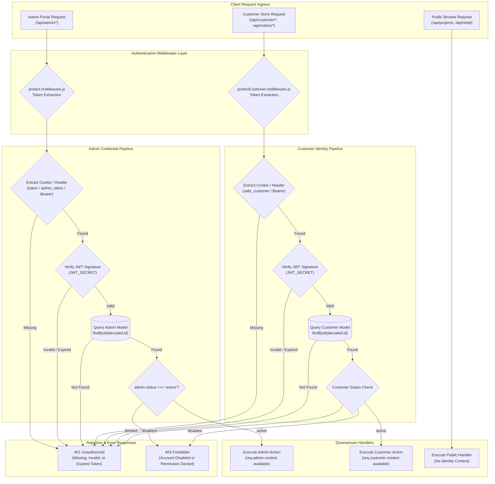

# Authentication & Authorization Architecture — Sabr Studio

The diagram below maps the dual-track authentication and access control architecture of Sabr Studio, illustrating how Admin and Customer identities are kept strictly separate without permission leaks.

---

### Comparison of Identity Systems

| Dimension | Admin Identity | Customer Identity |
|---|---|---|
| **Identity Provider** | Local Database (`Admin` collection) | Google OAuth 2.0 (Google Identity Services) |
| **Credential Type** | Email + bcrypt password hash | Google ID Token (RS256 signed JWT) |
| **Verification Logic** | `bcrypt.compare()` against salted hash | Cryptographic verification via Google JWKS |
| **Session Transport** | HTTP-only cookie (`token`, `admin_token`, `jwt`) | HTTP-only cookie (`sabr_customer`) |
| **Session Lifetime** | 24 Hours / 7 Days (`JWT_EXPIRES_IN`) | 365 Days (`CUSTOMER_JWT_EXPIRES_IN`) |
| **Bootstrap Strategy** | Automated first-run seed from env vars | Automatic just-in-time creation on initial login |
| **Deactivation Handling** | `status: 'disabled'` yields `403 Forbidden` | `status: 'deleted'` yields `401 Unauthorized` |
