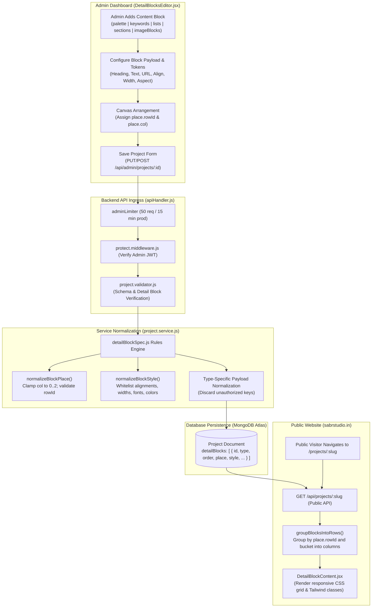

# CMS & Dynamic Detail Blocks Workflow — Sabr Studio

The diagram below details the architecture and data lifecycle of the dynamic Project CMS, from the administrative visual block editor (`DetailBlocksEditor.jsx`) to backend schema normalization, MongoDB storage, and public rendering (`ProjectDetail.jsx`).

---

### Detail Block Type Definitions

1. **`palette`**: Architectural material color swatches with name, hex/rgb values, and descriptions.
2. **`keywords`**: Key design descriptors and conceptual tags grouped under a section heading.
3. **`lists`**: Structured design criteria with intro paragraphs and bulleted or numbered items.
4. **`sections`**: Long-form editorial narratives with headings, intro passages, and multiple body paragraphs.
5. **`imageBlocks`**: Visual showcases supporting Cloudinary URLs, captions, subheadings, and bespoke layouts.
