# Database Entity Relationship Diagram — Sabr Studio

The diagram below reflects the verified database schemas and collections defined in `backend/models/*.model.js`.

```mermaid
erDiagram
    ADMIN {
        ObjectId _id PK
        string name "Required, Trimmed"
        string email "Required, Unique, Lowercase"
        string password "Hashed bcrypt, Select: false"
        string role "Enum: ['admin']"
        string status "Enum: ['active', 'disabled']"
        date lastLoginAt "Nullable"
        date createdAt
        date updatedAt
    }

    CUSTOMER {
        ObjectId _id PK
        string name "Required, Trimmed"
        string email "Required, Unique, Lowercase"
        string googleId "Unique Index (Partial Filter), Google Sub Claim"
        boolean emailVerified "Default: true"
        string avatar "Profile Image URL"
        string phone "Normalized phone"
        string role "Enum: ['customer']"
        string status "Enum: ['active', 'disabled', 'deleted']"
        date lastLoginAt "Nullable"
        date createdAt
        date updatedAt
    }

    CUSTOMER_ADDRESS {
        ObjectId _id PK
        string label "Default: Home"
        string fullName "Required"
        string phone "Required"
        string house "Required"
        string street "Required"
        string landmark "Optional"
        string city "Required"
        string state "Required"
        string pincode "Required"
        string country "Default: India"
        boolean isDefault "Default: false"
    }

    PROJECT {
        ObjectId _id PK
        string title "Required, Trimmed"
        string slug "Required, Unique, Lowercase"
        string category "Default: Residential"
        string location "Nullable"
        number year "Nullable"
        string area "Nullable"
        string description "Required"
        string shortDescription "Optional"
        string coverImage "URL"
        string coverImagePublicId "Cloudinary public_id"
        string gallery "Array of URLs"
        number price "Nullable, Min: 0"
        boolean published "Default: false"
        date createdAt
        date updatedAt
    }

    PROJECT_CATEGORY {
        ObjectId _id PK
        string name "Required, Unique"
        string slug "Lowercase"
        date createdAt
        date updatedAt
    }

    DETAIL_BLOCK {
        string id "Required, Unique per block"
        string type "Enum: [palette, keywords, lists, sections, imageBlocks]"
        number order "0-based render index"
        object place "Optional: { rowId, col }"
        object style "Optional: { align, width, fontSize, color, ... }"
    }

    RETAIL {
        ObjectId _id PK
        string title "Required, Trimmed"
        string slug "Required, Unique, Lowercase"
        string category "Default: Chair"
        string description "Required"
        string image "Primary Image URL"
        string imagePublicId "Cloudinary public_id"
        number price "Required, Min: 0"
        boolean availability "Default: true"
        number stock "Nullable (null = legacy untracked), Min: 0"
        boolean inStock "Default: true"
        string dimensions "Optional"
        string materials "Optional"
        boolean published "Default: false"
        date createdAt
        date updatedAt
    }

    RETAIL_CATEGORY {
        ObjectId _id PK
        string name "Required, Unique"
        string slug "Lowercase"
        date createdAt
        date updatedAt
    }

    ORDER {
        ObjectId _id PK
        string orderNumber "Required, Unique Index (e.g. SABR-ORD-2024-XXXX)"
        ObjectId user FK "Ref: Customer, Nullable for legacy"
        string idempotencyKey "Unique Sparse Index"
        number amount "Required, Total Payable"
        number subtotal "Subtotal before shipping"
        number shipping "Default: 0"
        string currency "Default: INR"
        string paymentStatus "Enum: [pending, paid, failed, cancelled, refunded]"
        string orderStatus "Enum: [pending, confirmed, processing, shipped, out_for_delivery, delivered, completed, cancelled]"
        string trackingId "Courier Tracking Identifier"
        date createdAt
        date updatedAt
    }

    ORDER_ITEM {
        string itemId "Required, Ref to Retail or Project"
        string itemType "Enum: ['project', 'retail']"
        string name "Required, Product title snapshot"
        number quantity "Required, Min: 1"
        string variant "Optional"
        number unitPrice "Required, Snapshot at checkout"
        number lineTotal "Required, unitPrice * quantity"
        string image "Snapshot Image URL"
    }

    ENQUIRY {
        ObjectId _id PK
        string name "Required, Trimmed"
        string email "Optional, Lowercase"
        string phone "Required"
        string projectType "Optional design selection"
        string message "Optional inquiry details"
        string source "Default: /contact"
        string status "Enum: ['new', 'contacted', 'pending']"
        string emailStatus "Enum: ['sent', 'failed', 'pending']"
        string emailError "Optional failure reason"
        date createdAt
        date updatedAt
    }

    %% Relationships
    CUSTOMER ||--o{ CUSTOMER_ADDRESS : "embeds addresses[]"
    CUSTOMER ||--o{ ORDER : "places (user)"
    ORDER ||--|{ ORDER_ITEM : "embeds items[]"
    PROJECT ||--o{ DETAIL_BLOCK : "embeds detailBlocks[]"
```

---

### Collection Mapping Details

- **`admins`**: Maps to `Admin` model. Stores administrative credentials.
- **`customers`**: Maps to `Customer` model. Stores Google-authenticated retail shoppers and their embedded delivery address book.
- **`projects`**: Maps to `Project` model. Stores design case studies and embedded dynamic detail blocks.
- **`projectcategories`**: Maps to `ProjectCategory` model. Stores project taxonomy.
- **`reatils`**: Maps to `Retail` model (collection explicitly pinned to `reatils` in schema options). Stores furniture catalogue items.
- **`retailcategories`**: Maps to `RetailCategory` model. Stores product categories.
- **`orders`**: Maps to `Order` model. Stores e-commerce orders, delivery address snapshots, and line items.
- **`enquires`**: Maps to `Enquiry` model (collection explicitly pinned to `enquires`). Stores inbound prospective client inquiries.
