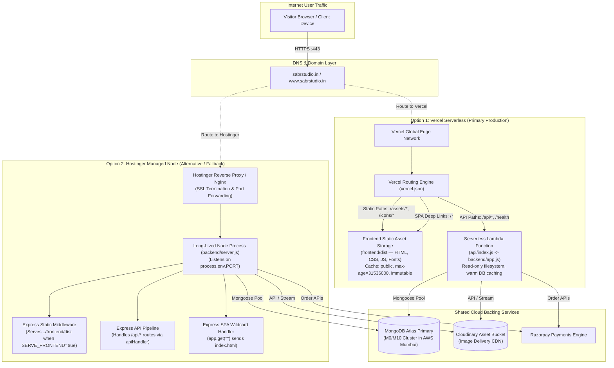

# Production Deployment Architecture — Sabr Studio

The diagram below illustrates the dual production deployment strategy supported by the codebase: Vercel Serverless Architecture (Static Edge + Serverless Node) versus Hostinger Managed Node.js Architecture (Same-Domain Monolithic Hosting).

---

### Comparison of Deployment Modes

| Characteristic | Vercel Deployment | Hostinger Deployment |
|---|---|---|
| **Frontend Delivery** | Global Edge CDN (`frontend/dist`) | Express `express.static` (`frontend/dist`) |
| **API Execution** | Ephemeral serverless lambdas (`api/index.js`) | Long-lived persistent Node.js daemon (`backend/server.js`) |
| **Process Model** | Auto-scaled per-request function invocations | Single continuous event loop listening on dynamic port |
| **Filesystem Status** | Read-only (enforces Multer memory storage) | Writable local disk (memory storage still preferred) |
| **Database Connection** | Cached on `globalThis.__sabrMongo` | Persistent single connection maintained across restarts |
| **Deep Link Routing** | Managed by `vercel.json` rewrite to `/index.html` | Managed by Express wildcard `app.get('*')` |
| **Activation Flag** | Default behavior when `VERCEL` env is set | Enabled explicitly via `SERVE_FRONTEND=true` |
