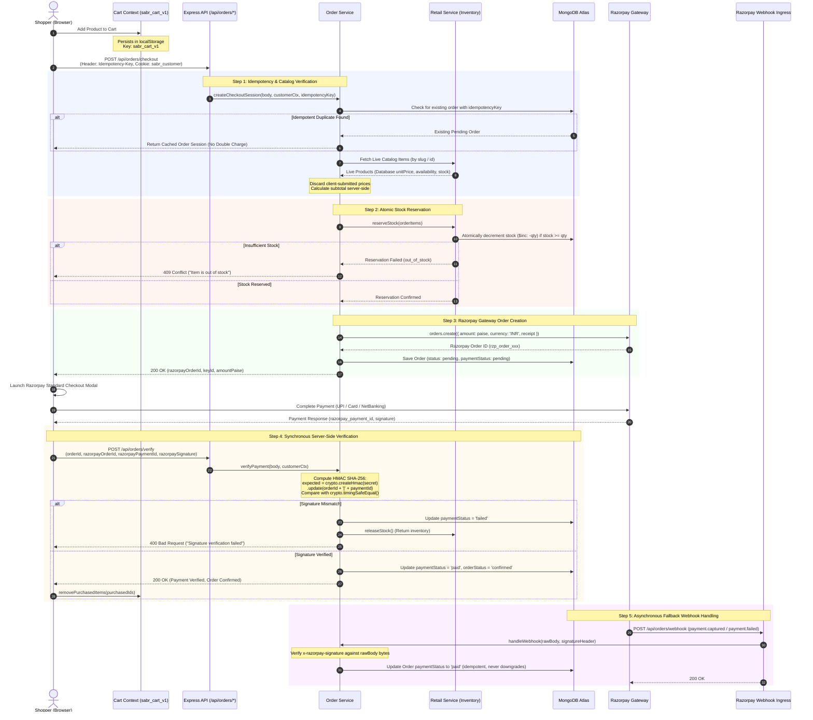

# E-Commerce & Razorpay Payment Lifecycle — Sabr Studio

The diagram below details the entire commerce flow from cart curation to server-side price validation, atomic stock reservation, Razorpay order generation, HMAC signature verification, and asynchronous webhook handling.

---

### Core Financial & Inventory Safeguards

1. **Client Price Zero-Trust:** All prices, discounts, and currency calculations are strictly performed against the database snapshot. Client-sent prices are only checked to detect cart price changes (`priceChanges` warnings).
2. **Idempotency Keys:** Protects shoppers against accidental duplicate charges caused by network timeouts or impatient double-clicks.
3. **Atomic Stock Locking:** Inventory is reserved prior to generating the Razorpay payment session. If checkout aborts or the payment fails signature checks, the reserved stock is automatically returned to the catalog.
4. **Dual Verification Channels:** Both frontend callback verification and backend server-to-server webhooks update the order state. Paid status is strictly final and can never be reversed or downgraded by webhook replays.
