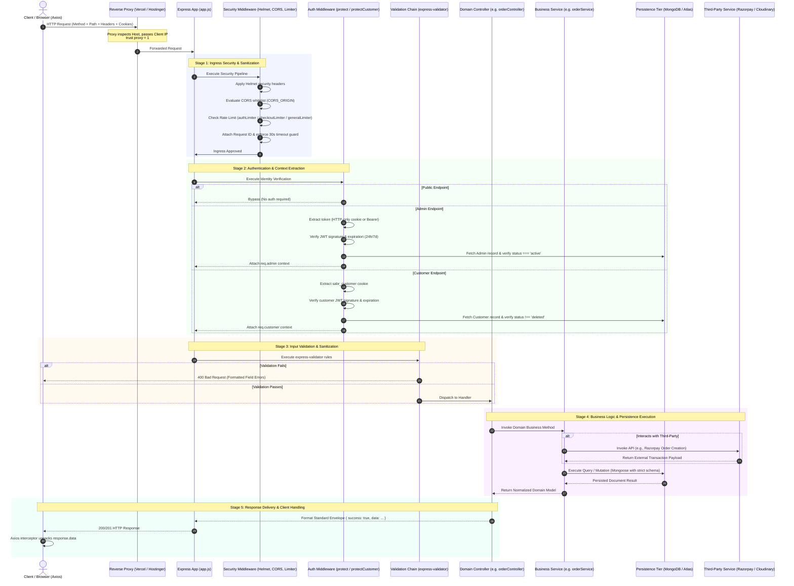

# Request Lifecycle — Sabr Studio

The diagram below traces the end-to-end lifecycle of an HTTP request traversing the Sabr Studio application stack: from the client browser through network proxies, security middleware, authentication gates, validation chains, business controllers, persistence layers, and client response handling.

---

### Key Lifecycle Principles

1. **Standardized Response Envelope:** Every response adheres strictly to `{ success: boolean, data?: any, message?: string, errors?: Array<{ field, message }> }`.
2. **Context Enrichment:** Middleware attaches immutable identity contexts (`req.admin` or `req.customer`) ensuring downstream controllers never parse raw tokens or trust client-supplied user identifiers.
3. **Database Fail-Safe:** In production, if MongoDB Atlas is disconnected or reconnecting, the database guard immediately intercepts incoming API requests and returns a clean `503 Service Unavailable (DB_UNAVAILABLE)` rather than hanging or silently falling back to mock fixtures.
