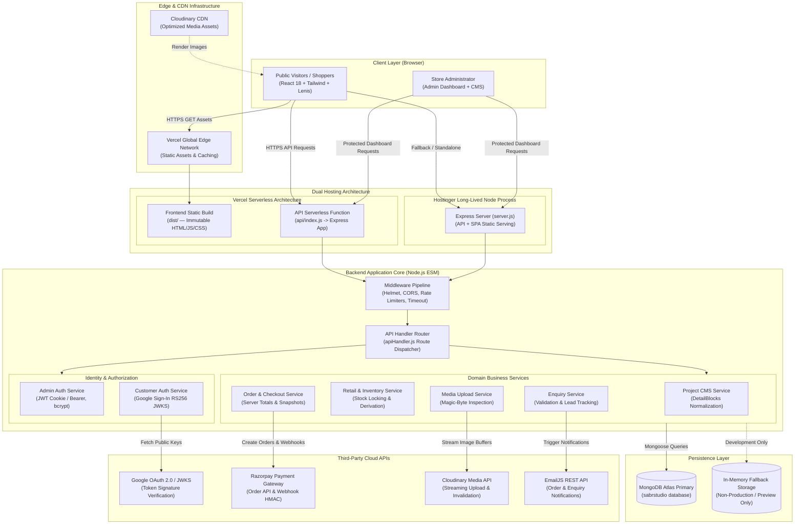

# System Architecture — Sabr Studio

The diagram below illustrates the high-level architecture of Sabr Studio, detailing the separation between public clients, the administrative panel, the dual-deployment backend layer, the database tier, and external integrations.

---

### Architectural Characteristics

1. **Separation of Concerns:** The public client interface, administrative CMS, and API handler are strictly separated. The API functions as a headless service consumed by both public shopping interfaces and protected admin modules.
2. **Dual-Deployment Resilience:** The application is architected to execute either as serverless lambdas on Vercel (`api/index.js`) or as a monolithic stateful Node.js process on managed hosting platforms like Hostinger (`backend/server.js`).
3. **Defense in Depth:** Request headers are scrutinized via Helmet, origin-gated via CORS policies, guarded by module-specific rate limiters (login, enquiry, checkout, admin), and protected by body payload verification.
4. **Isolated Identity Tracks:** Store shoppers authenticate exclusively via Google Sign-In with server-side public key verification; administrators authenticate via bcrypt credentials and HTTP-only JWT cookies.
